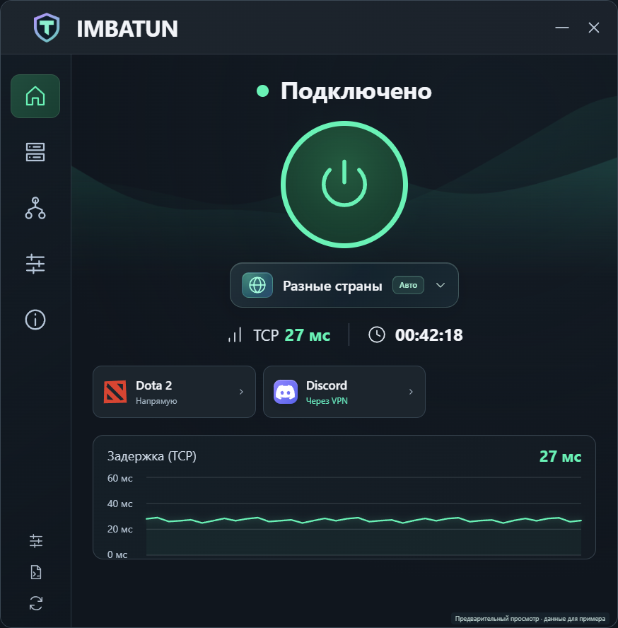

  
  <h1>IMBATUN</h1>
  
<strong>VPN там, где нужен. Игры — напрямую.</strong>

  
Discord, Telegram, YouTube, ChatGPT и Twitch через VPN. Российские сайты и распознанные игры — через обычное подключение.

  

    
    
    
  

  
<a href="https://imbatun.ru/"><strong>Сайт imbatun.ru</strong></a> &nbsp; · &nbsp; <a href="https://imbatun.ru/download"><strong>↓ Скачать для Windows</strong></a> &nbsp; · &nbsp; <a href="https://t.me/imbavpn_bot">Получить доступ</a> &nbsp; · &nbsp; <a href="https://github.com/array05/IMBATUN/releases">Все выпуски</a>

  
   Предварительный просмотр интерфейса. Показатели на изображении приведены для примера.

## IMBA VPN — для телефона и компьютера

**Одна VLESS-подписка IMBA VPN — VPN на телефоне и IMBATUN на Windows без доплаты за программу.** Оформите доступ в [Telegram-боте IMBA VPN](https://t.me/imbavpn_bot), настройте телефон по инструкции бота и войдите с этой же подпиской в IMBATUN.

| Что вы получаете | Как это работает |
| :--- | :--- |
| VPN для телефона | Подключение через совместимый VPN-клиент по инструкции в боте |
| IMBATUN для Windows бесплатно | Приложение, обновления, правила для сайтов и игр входят без отдельной оплаты при действующей подписке |
| Удобный вход | Подтверждение через Telegram вместо ручного переноса ключей в IMBATUN |
| Выбор локаций | Автоматический выбор рабочего сервера или подключение к выбранной локации |

Сам VPN-доступ оплачивается по тарифу IMBA VPN. Срок подписки, доступные локации и лимит устройств указаны в боте. [Посмотреть сайт](https://imbatun.ru/) · [Выбрать подписку](https://t.me/imbavpn_bot).

## Сервисы и игры

**Через VPN:** Discord, Telegram, YouTube, ChatGPT, Twitch и другие зарубежные сервисы.

**Напрямую по умолчанию для распознанных игр:** Counter-Strike 2, Dota 2, VALORANT, League of Legends, Fortnite, Roblox, Apex Legends и World of Warcraft. Маршрут отдельного приложения можно изменить в настройках.

## Одно приложение для связи и игр

| Подключение | Маршрутизация | Контроль |
| :--- | :--- | :--- |
| Автоматический поиск рабочего сервера или выбор локации вручную | Зарубежные сервисы через VPN, российские адреса и игры напрямую | Статус соединения, задержка и журнал событий |
| Вход через Telegram без ручного копирования ключей | Исключения для отдельных сайтов и приложений | Игровой оверлей и горячая клавиша |
| Обновление из самого приложения | Обновляемые списки адресов | Диагностика сайта или приложения и добровольные отчёты об ошибках |

## Начать за минуту

1. **Скачайте** [IMBATUN для Windows](https://imbatun.ru/download) и распакуйте архив целиком.
2. **Запустите `IMBATUN.exe`** из распакованной папки. Оставьте рядом папку `core` — она нужна для работы приложения.
3. **Войдите через Telegram:** отсканируйте QR-код или откройте бота, выберите действующую VLESS-подписку и подтвердите вход.
4. **Нажмите кнопку подключения.** Можно оставить «Автоматически» или выбрать нужную локацию.

Нужны Windows 10/11 x64, .NET Framework 4.8 и права администратора для виртуального адаптера. Основной интерфейс использует Microsoft Edge WebView2 Runtime. Если он отсутствует или не запускается, автоматически откроется упрощённый интерфейс Windows с подключением, выбором сервера, настройками и диагностикой. Доступ оформляется в [боте IMBA VPN](https://t.me/imbavpn_bot).

## Обновление 2.3.11

Все основные изменения 2.3.10 и последние улучшения интерфейса — в одном выпуске.

- **Игра продолжает идти напрямую при обрыве VPN.** Сохраняем прямые игровые соединения при потере связи с VPN-сервером, восстановлении VPN и его обычном включении или выключении. Это работает, пока запущен сетевой движок IMBATUN; защита от аварии всего движка в эту версию не входит.
- **Автоматический поиск рабочего сервера.** После нескольких неудачных попыток восстановления IMBATUN проверяет другие серверы и пробует подключиться к рабочему. В настройках должно быть включено восстановление соединения.
- **Новый интерфейс.** Мятное оформление, плавные волны, понятный выбор локаций. Оставлены только серверы IMBA VPN.
- **Запущенные приложения на главном экране.** Игры, браузеры и мессенджеры показаны компактными карточками с переносом на следующий ряд. Нажатие открывает настройки именно выбранного приложения: напрямую, через VPN или по общим правилам. Проводник и служебные окна скрыты.
- **Помощь с Discord.** Кнопка «Discord не открывается?» после подтверждения закрывает выбранный клиент, переносит временный кеш в резервную папку и запускает Discord заново. Вход и настройки сохраняются.
- **Удобнее во время игры.** Игровая плашка стала компактнее и прозрачнее. В программе и оверлее показана TCP-задержка до входного сервера. Исправлены диагностика VPN и размещение графика при нескольких рядах приложений.

Дополнительно в 2.3.11: компактная полупрозрачная плашка сервера с размытием, цветной глобус для разных стран, бейдж «Авто» и исправленные отступы возле кнопки подключения.

## Уже установлен IMBATUN?

В версии **2.3.3 и новее** нажмите **«Проверить обновления» → «Установить»**. Программа проверит пакет, заменит файлы и перезапустится. Настройки и сохранённый вход остаются на месте. Обновляйтесь вне матча: установка перезапускает IMBATUN.

Если установлена **2.3.2 или более ранняя версия**, скачайте [актуальный Windows ZIP](https://imbatun.ru/download), полностью закройте старый IMBATUN и распакуйте архив целиком с заменой файлов. После перехода на новый сервис может понадобиться один раз подтвердить вход через Telegram. Настройки маршрутов сохраняются.

Полное описание — в [выпуске 2.3.11](https://github.com/array05/IMBATUN/releases/tag/v2.3.11).

## Как идёт трафик

| Что открываете | Маршрут по умолчанию |
| :--- | :--- |
| Зарубежные сайты и приложения | Через VPN |
| Российские домены и IP-адреса из списков | Напрямую |
| Распознанные игры и добавленные игровые `.exe` | Напрямую |
| Лаунчеры и загрузки | По общим правилам адресов |
| Сайты и приложения с ручными исключениями | По вашему правилу |

Правила можно изменить в **«Настройки»**. Страна определяется по адресам, а не языку сайта; списки могут ошибаться. Другой одновременно включённый VPN может влиять на маршрут.

<strong>Вопросы и помощь</strong>

### Какой архив скачивать?

В [последнем выпуске](https://github.com/array05/IMBATUN/releases/latest) откройте **Assets** и выберите **`IMBATUN-2.3.11-Windows-x64.zip`**. Это готовое приложение с EXE и необходимыми компонентами.

**`Source code (zip)`**, **`Source code (tar.gz)`** и **Code → Download ZIP** — автоматические архивы содержимого репозитория. Здесь размещены документация и выпуски; исходный код оболочки IMBATUN не опубликован. Поэтому архив старого тега может содержать только README. Для установки используйте готовый Windows ZIP из Assets.

### Что делать, если подключение не работает?

Обновите приложение, попробуйте другую локацию и откройте **«Настройки» → «Диагностика»**. Проверка отправит отчёт в поддержку и покажет его номер. Если старая версия зависла на заставке, полностью закройте её и распакуйте новый Windows ZIP целиком. Для принудительного запуска упрощённого режима используйте `IMBATUN.exe --simple-ui`. Не включайте одновременно несколько VPN при проверке. Если проблема повторяется, напишите в [Issues](https://github.com/array05/IMBATUN/issues), указав версию IMBATUN, Windows и текст ошибки. Не публикуйте ключи, пароли и ссылки подписки.

### Что означает задержка для RUS → NL / Finland?

**«TCP до сервера»** — задержка TCP-соединения от компьютера напрямую до входного сервера. Для RUS → Finland это российский вход. Этот показатель отображается в программе и оверлее; он не является пингом игрового сервера. Работоспособность полного VPN-маршрута проверяется отдельно внутри программы.

### Почему VPN не переподключается сам?

Включите **«Настройки» → «Восстанавливать соединение» → «Сохранить»**. После нескольких неудачных попыток IMBATUN проверяет другие серверы и переключается на рабочий. При выключенной настройке повторные подключения не выполняются. Если сетевой процесс остановился, журнал версии 2.2.0 и новее сохраняет его тип и код завершения.

### Как проверить отдельный сайт или приложение?

Откройте **«Сайт или приложение»** на странице подключения или в настройках. Для сайта проверяются правила, DNS и HTTPS; для приложения показываются его правила и текущие соединения. Можно дополнительно проверить UDP через VPN, изменить правило или сохранить отчёт на компьютере. Эта проверка не отправляет отчёт в поддержку. Контрольный UDP-пакет не заменяет проверку конкретного звонка или игры.

### Где игровой оверлей?

Он включается в настройках. По умолчанию горячая клавиша — **Ctrl + Shift + O**. Оверлей работает в оконном режиме и безрамочном полноэкранном режиме; совместимость зависит от игры.

### Подойдёт ключ WireGuard?

Windows-клиент IMBATUN использует VLESS-доступ из бота. Ключи WireGuard для него не подходят.

### Какие данные отправляются в отчётах?

Диагностика по нажатию кнопки сразу отправляет состояние приложения, результаты проверок и адреса проверяемых серверов; копия сохраняется в `%LOCALAPPDATA%\IMBATUN\diagnostic-report.json`. Автоматические отчёты выключены до вашего согласия. Адреса доменов/IP включаются только с отдельного разрешения. Отчёты можно отключить в настройках; сервер хранит их семь дней. Ключи, пароли и содержимое страниц в отчёты не включаются.

## Компоненты

IMBATUN использует [Xray-core](https://github.com/XTLS/Xray-core), [sing-box](https://github.com/SagerNet/sing-box), [Wintun](https://www.wintun.net/) и списки адресов [MetaCubeX](https://github.com/MetaCubeX/meta-rules-dat). Лицензии компонентов включены в Windows ZIP.

<a href="https://imbatun.ru/">Сайт</a> · <a href="https://t.me/imbavpn_bot">Telegram</a> · <a href="https://github.com/array05/IMBATUN/releases/latest">Скачать</a> · <a href="https://github.com/array05/IMBATUN/issues">Сообщить о проблеме</a>

